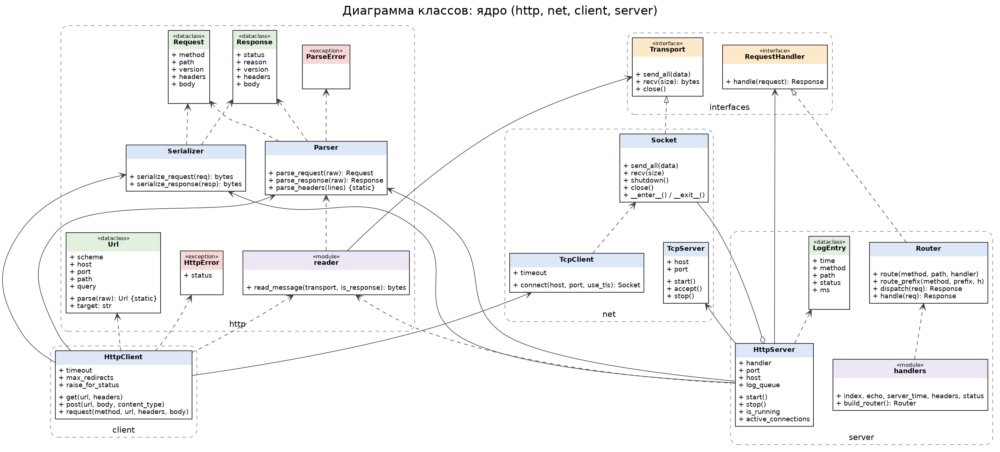
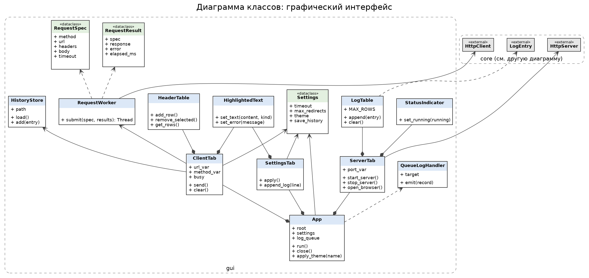

# HTTP-клиент и сервер с GUI на Python

Десктопное приложение: HTTP-клиент и HTTP-сервер, написанные «с нуля» на сокетах (без `requests`, `http.server` и т. п.), с графическим интерфейсом на Tkinter. Вся сетевая работа идёт в фоновых потоках, интерфейс не замерзает.

## Возможности

**Клиент (вкладка «Клиент»)**
- URL, метод GET/POST, таблица заголовков, тело запроса (для POST)
- Ответ: статус, заголовки, тело с подсветкой JSON и HTML
- Индикатор «Отправка…», кнопки «Отправить» и «Очистить»
- Таймаут, `Content-Length` и `Transfer-Encoding: chunked`, https через `ssl`, следование за редиректами 3xx
- Ошибки (`ConnectionError`, `TimeoutError`, `ParseError`, неверный ввод) показываются в области ответа

**Сервер (вкладка «Сервер»)**
- Порт, кнопки «Запустить» / «Остановить», индикатор состояния (зелёный/красный)
- Таблица лога: время, метод, путь, статус, время обработки в мс
- Кнопки «Очистить лог» и «Открыть в браузере»
- Отдельный поток на каждое соединение, keep-alive, ответ `400 Bad Request` на мусор

| Маршрут | Метод | Ответ |
|---|---|---|
| `/` | GET | HTML-страница «Hello» |
| `/echo` | POST | тело запроса, `Content-Type` сохраняется |
| `/time` | GET | текущее время в JSON |
| `/headers` | GET | заголовки запроса в JSON |
| `/status/<code>` | GET | ответ с указанным кодом (200–599) |
| любой другой | любой | `404 Not Found` |

**Настройки (вкладка «Настройки»):** таймаут, число редиректов, светлая/тёмная тема, сохранение истории запросов в `history.json`, журнал приложения (также пишется в `http_gui.log`).

## Требования

- Python 3.10 или новее
- Tkinter (входит в стандартную поставку Python для macOS/Windows; на Linux: `sudo apt install python3-tk`)
- Для тестов и линтеров: `pytest`, `flake8`, `pylint`

## Установка и запуск

```bash
git clone https://github.com/skKristinka/---Python.git
cd ---Python
python -m venv .venv && source .venv/bin/activate   # Windows: .venv\Scripts\activate
pip install -r requirements.txt
python -m src.main
```

## Проверка сервера из терминала

Запустите сервер на вкладке «Сервер» (порт 8080), затем:

```bash
curl -v http://localhost:8080/
curl -v -X POST -d "hello" http://localhost:8080/echo
curl -v http://localhost:8080/status/418
curl -v http://localhost:8080/nonexistent
python -m scripts.load_test http://localhost:8080/ -n 100   # 100 параллельных запросов
```

## Тесты и линтеры

```bash
pytest tests/ -v                       # все тесты
pytest tests/test_integration.py -v    # только интеграционные (клиент <-> сервер)
python -X dev -m pytest tests/ -v      # режим разработчика: ищем гонки и утечки ресурсов
flake8 src/ tests/ scripts/
make pylint
```

Тест `tests/test_gui_smoke.py` открывает настоящее окно Tk; без дисплея (например, в CI) он пропускается.

## Структура проекта

```
src/
  interfaces.py      ABC: RequestHandler, Transport
  http/              Url, Request, Response, Parser, Serializer, read_message, исключения
  net/               Socket (контекстный менеджер), TcpClient, TcpServer
  client/            HttpClient
  server/            HttpServer, Router, обработчики маршрутов
  gui/               App, ClientTab, ServerTab, SettingsTab, виджеты, тема, проверка ввода
  logging_setup.py   logging: файл + GUI
  main.py            точка входа
tests/               unit-, интеграционные и GUI-smoke тесты
scripts/             load_test.py — нагрузочный скрипт
docs/                диаграммы классов (PlantUML + PNG), шаблон отчёта
```

## Архитектура

Слои: `http` (разбор и сборка сообщений) → `net` (сокеты) → `client` / `server` (логика) → `gui` (интерфейс). Подробности, схема потоков и обработка ошибок — в [documentation.md](documentation.md).





Исходники диаграмм: [docs/class_diagram.puml](docs/class_diagram.puml), [docs/class_diagram_gui.puml](docs/class_diagram_gui.puml).
